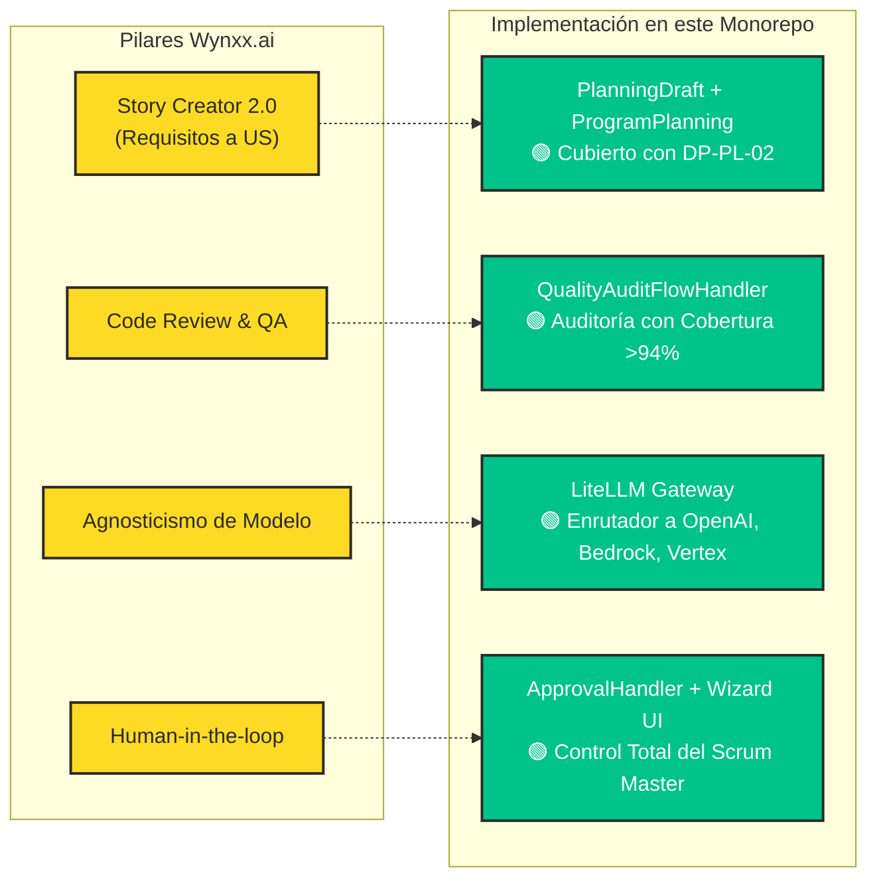

# Filosofía del Harness de Agentes y Estrategia de IA

> **Cuadrante Diátaxis: Explicación (Understanding-Oriented)**  
> En esta sección se analiza la motivación arquitectónica detrás del concepto de *Harness*, el
> desplazamiento de los cuellos de botella del SDLC y la comparativa estratégica frente a soluciones
> de mercado como Wynxx.ai.

---

## 1. ¿Por qué un "Harness" de Agentes?

En ingeniería de software, un *harness* (arnés de pruebas u orquestador) es una estructura de
soporte que envuelve, alimenta y gobierna un componente bajo evaluación o ejecución controlada.

En el contexto de Inteligencia Artificial Generativa:
> **"Un modelo de lenguaje sin arnés es un generador estocástico sin memoria, sin límites normativos
> y sin herramientas de ejecución."**

El **Harness de Agentes** implementado en este monorepo dota a los modelos de lenguaje de:

1. **Gobernanza y Reglas Normativas:** Restricciones estrictas que el modelo no puede obviar (ej.
   directiva **DP-PL-02** para separar construcción de software de habilitación operativa HyMS).
2. **Contexto Estructurado y Memoria:** Acceso a especificaciones maestras en Markdown
   (`SpecStoragePort`) y memoria vectorial de planeaciones pasadas (`PgVectorPlanningAdapter`).
3. **Toolificación Estandarizada:** Capacidad de ejecutar acciones sobre Azure DevOps mediante
   contratos universales (MCP).
4. **Supervisión Humana (*Human-in-the-Loop*):** El agente propone y desglosa planes, pero ninguna
   historia ni cambio se publica sin confirmación explícita del usuario (`ApprovalHandler`).

---

## 2. El Desplazamiento de los Cuellos de Botella en el SDLC

La adopción masiva de asistentes de código (GitHub Copilot, Cursor) demostró una realidad operativa:
**escribir código ya no es el cuello de botella**. La fricción en los equipos de desarrollo se
trasladó aguas arriba y aguas abajo:

| Fase del SDLC                   | Problema Tradicional con Asistentes Aislados                                              | Solución del Harness de Agentes                                                                                                                      |
|---------------------------------|-------------------------------------------------------------------------------------------|------------------------------------------------------------------------------------------------------------------------------------------------------|
| **Definición de Requisitos**    | Historias de usuario ambiguas, sin criterios de aceptación formales o mal dimensionadas.  | Asistente estructurado `ProgramPlanningUseCase` que fuerza descomposición en sprints y verificación de capacidad.                                    |
| **Estimación de Complejidad**   | El desarrollador adivina puntos o el modelo inventa números sin criterio.                 | Servicio `ComplexityEstimation`: umbral estricto `> 8` puntos para división obligatoria (**DP-02**) y aviso explícito si no hay certeza (**DP-03**). |
| **Gobernanza de Despliegue**    | Mezcla de criterios de aceptación de desarrollo con tareas de infraestructura productiva. | Regla HyMS (**DP-PL-02**): delimitación clara entre HU (construcción hasta QA) y HA (acompañamiento HyMS y producción).                              |
| **Aislamiento de Herramientas** | Cada script o extensión usa APIs ad-hoc que quedan obsoletas al actualizar versiones.     | Estandarización con **Model Context Protocol (MCP)** en `azure-devops-mcp`.                                                                          |

---

## 3. Comparativa Estratégica: Wynxx.ai vs. Este Monorepo

En el análisis de brecha corporativo (referenciado en `WYNXX_GAP_ANALYSIS.md`), se contrastaron las
capacidades del monorepo frente al ecosistema Wynxx (GFT Technologies / Bradesco Seguros):

### Ventajas Competitivas Clave del Monorepo:

1. **Agnosticismo de Modelos sin Vendor Lock-in:**  
   En lugar de implementar abstracciones propietarias frágiles, el proyecto se conecta a través del
   protocolo estándar OpenAI hacia **LiteLLM**. Esto permite conmutar en caliente entre modelos de
   Google, Microsoft o AWS mediante variables de entorno (`AI_BASE_URL` y `AI_MODEL`).
2. **Arquitectura Limpia y Resiliencia en Java 21:**  
   Frente a prototipos en Python o scripts de terminal, el núcleo del Harness está implementado en
   Java 21 con Clean Architecture oficial, validado por 407 pruebas automáticas y 0 violaciones de
   ArchUnit.
3. **Evolución Segura hacia Kafka (A2A):**  
   El diseño desacoplado del puerto `AgentResponseGateway` con el patrón Null Object permite
   desplegar el agente hoy sobre HTTP síncrono y encender mensajería asíncrona sobre Kafka en el
   futuro con cero impacto en el dominio.
