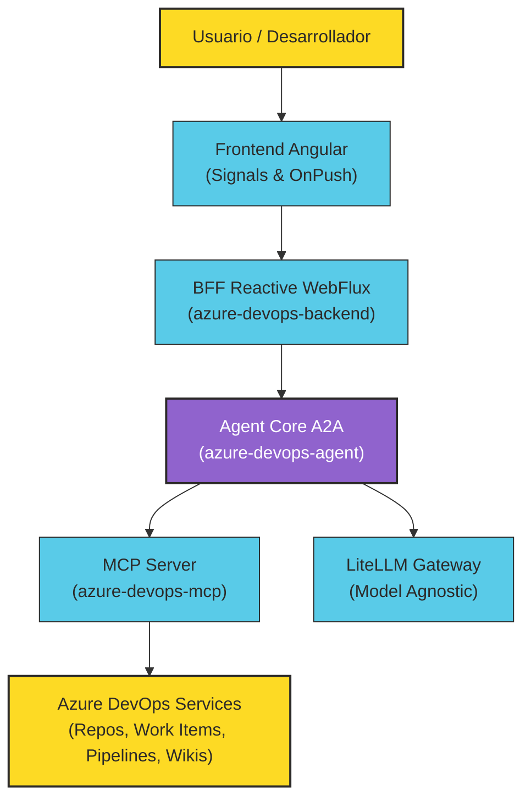

# Azure DevOps Agent Harness

> **Portal Oficial de Documentación Técnica y Arquitectura Viva**  
> Diseñado bajo el marco **Diátaxis** y el estándar **TechDocs Backstage**, utilizando la paleta
> corporativa oficial de **Bancolombia**.

---

## 🎯 ¿Qué es el Harness de Agentes?

El **Azure DevOps Agent Harness** es una plataforma desacoplada y reactiva diseñada para acelerar y
gobernar el ciclo de vida de desarrollo de software (SDLC) sobre Azure DevOps mediante agentes de
Inteligencia Artificial colaborativos.

El sistema resuelve los cuellos de botella en la definición de requisitos, refinamiento de historias
de usuario, estimación de complejidad, asignación de capacidad por sprints y auditoría de calidad de
código mediante orquestación de agentes **Agent-to-Agent (A2A)** y herramientas estándar **Model
Context Protocol (MCP)**.

---

## 🧩 Componentes del Ecosistema

El monorepo agrupa 4 módulos especializados y desacoplados:

| Componente                                                                                   | Stack Tecnológico                               | Rol y Responsabilidad                                                                                                                                           |
|----------------------------------------------------------------------------------------------|-------------------------------------------------|-----------------------------------------------------------------------------------------------------------------------------------------------------------------|
| **[`azure-devops-agent`](explanation/ecosystem-architecture.md#1-azure-devops-agent)**       | Java 21 · Spring WebFlux · Clean Architecture   | Motor del Harness: resolución de 7 intenciones (`IntentResolver`), Program Planning, Story Engine normativo HyMS, y transporte dual A2A (JSON-RPC 2.0 y Kafka). |
| **[`azure-devops-backend`](explanation/ecosystem-architecture.md#2-azure-devops-backend)**   | Java 21 · Spring WebFlux · Project Reactor      | Backend-for-Frontend (BFF): orquestación de API REST, ingesta de especificaciones y sincronización de tareas reactivas por SSE.                                 |
| **[`azure-devops-frontend`](explanation/ecosystem-architecture.md#3-azure-devops-frontend)** | Angular 21/22 · Standalone · Signals · Tailwind | Interfaz gráfica interactiva: Wizard guiado de Program Planning, visor interactivo de specs y dashboard de calidad con auditoría de historias.                  |
| **[`azure-devops-mcp`](explanation/ecosystem-architecture.md#4-azure-devops-mcp)**           | Java 21 · Spring Boot · Model Context Protocol  | Servidor MCP que toolifica Azure DevOps: gestión de Work Items, consultas WIQL, logs de Pipelines, Wikis y Pull Requests.                                       |

---

## 🧭 Navegación Diátaxis: Encuentra lo que Necesitas

La documentación está organizada en cuatro cuadrantes según tu objetivo:

- :material-school:{ .lg .middle } __Tutoriales__

  ---

  Aprende paso a paso cómo clonar, configurar y levantar los cuatro módulos del monorepo en local en
  menos de 5 minutos.

  [:octicons-arrow-right-24: Ir a Primeros Pasos](tutorials/quickstart-local-environment.md)

- :material-wrench:{ .lg .middle } __Guías Prácticas (How-To)__

  ---

  Recetas y procedimientos directos: ejecutar ciclos de planeación `/plan`, registrar nuevas
  herramientas MCP y configurar LiteLLM.

  [:octicons-arrow-right-24: Ver Guías How-To](how-to/run-program-planning.md)

- :material-book-open-variant:{ .lg .middle } __Referencia Técnica__

  ---

  Especificaciones exactas de contratos: JSON-RPC 2.0 A2A, Agent Card, endpoints REST/SSE, catálogo
  de herramientas MCP y variables `.env`.

  [:octicons-arrow-right-24: Consultar Contratos](reference/agent-a2a-contracts.md)

- :material-lightbulb:{ .lg .middle } __Arquitectura y ADRs__

  ---

  Fundamentos teóricos, comparativa contra Wynxx, diagramas interactivos Archify y registro de las 6
  decisiones de diseño (ADRs).

  [:octicons-arrow-right-24: Explorar Arquitectura](explanation/ecosystem-architecture.md)

---

## 📊 Diagramas Interactivos Archify (Showcase)

Para una exploración visual de alta fidelidad, consulta los tres diagramas interactivos compilados
con Archify en `docs/diagrams/`:

* 📍 **[Diagrama de Arquitectura de Software](diagrams/architecture.html)**: Topología de clientes,
  capas internas, adaptadores y servicios externos.
* ⚡ **[Diagrama de Secuencia Principal](diagrams/sequence_main.html)**: Traza cronológica de la
  transacción de Program Planning y refinamiento.
* 🔀 **[Diagrama de Workflow de Intenciones](diagrams/workflow_main.html)**: Máquina de estados,
  compuertas de decisión, directiva HyMS (**DP-PL-02**) y aprobación humana.

---

## 🏆 Métricas de Calidad y Confiabilidad

* **Pruebas Automatizadas:** 407 pruebas en verde en `azure-devops-agent` (100% pasando).
* **Cobertura de Código:** $\ge 94\%$ en `domain/model` y `domain/usecase`.
* **Reglas de Arquitectura:** 0 violaciones de ArchUnit y 0 clases mayores a 300 líneas de código
  (*Clean Architecture* estricta).
* **Mutation Testing (PIT):** Fuerza de mutación $\ge 95\%$ en adaptadores críticos.
